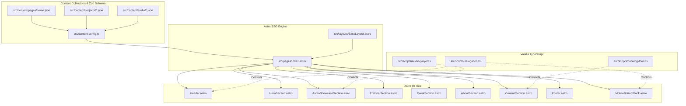
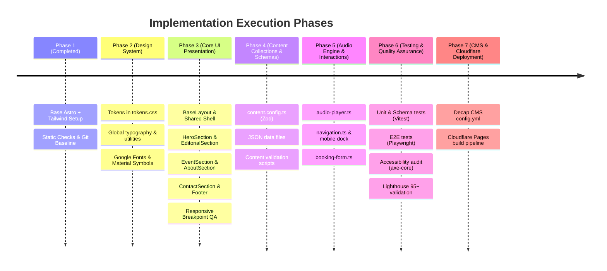

# Technical Architecture Specification — Naulia Zahra Creative Portfolio

| Document Information | Details |
| :--- | :--- |
| **Project Name** | Naulia Zahra Creative Portfolio |
| **Document Version** | 1.0 |
| **Author** | Senior Astro Architect |
| **Target Framework** | Astro v5 / v7 + TypeScript (Strict) + Tailwind CSS v4 |
| **Content Engine** | Astro Content Collections + Zod Schema Validation |
| **CMS Platform** | Decap CMS (GitHub Direct Publishing) |
| **Deployment Target** | Cloudflare Pages (Static Site Generation — SSG) |
| **Design Source of Truth** | Google Stitch Project `Naulia Zahra Creative Portfolio` (`projects/15143213659924096057`) |
| **Design Spec Reference** | [`docs/DESIGN.md`](file:///Users/amfs/StudioProjects/naulia-personal-portofolio/docs/DESIGN.md) & [`docs/PRD.md`](file:///Users/amfs/StudioProjects/naulia-personal-portofolio/docs/PRD.md) |

---

## 1. Architectural Principles & System Overview

In accordance with [`AGENTS.md`](file:///Users/amfs/StudioProjects/naulia-personal-portofolio/AGENTS.md) and [`docs/PRD.md`](file:///Users/amfs/StudioProjects/naulia-personal-portofolio/docs/PRD.md), this application is engineered under a **Static-First, Zero-JS by Default** paradigm:

1. **Idiomatic Astro & Native TypeScript**: Pure `.astro` components for layout and presentation. No React, Preact, Vue, or Svelte frameworks are introduced.
2. **Standard Native Web APIs**: Client-side interactions (audio playback, section filter tabs, mobile navigation docks, and form state feedback) are powered by lightweight, modular vanilla TypeScript scripts running directly in browser runtimes via `<script>` tags or external modules.
3. **Strict Separation of Concerns**: UI components are presentation-only, driven by strongly typed props. Content originates strictly from validated Astro Content Collections (`src/content/`).
4. **Single-Page Portfolio Flow**: Smooth vertical scrolling between landmark sections with deep-linking anchors (`#home`, `#audio`, `#editorial-portfolio`, `#mc-live-stage`, `#about`, `#contact`).
5. **Tailwind CSS v4 Integration**: Native CSS `@theme` tokens matching the *Curated Lumina* design system directly without legacy JavaScript configuration.



---

## 2. Section & Component Hierarchy

The single-page portfolio layout in `src/pages/index.astro` is composed of the following component tree:

```
src/layouts/BaseLayout.astro
└── src/pages/index.astro
    ├── <Header />
    │   ├── <BrandWordmark />
    │   ├── <AvailabilityBadge />
    │   ├── <DesktopNav />
    │   └── <HeaderCTA />
    │
    ├── <main id="main-content">
    │   │
    │   ├── <HeroSection id="home" />
    │   │   ├── <AvailabilityBadge />
    │   │   ├── <HeroHeadline />
    │   │   ├── <HeroSubtitles />
    │   │   ├── <HeroActions />
    │   │   ├── <TrustBadgesBar />
    │   │   └── <HeroVisualDeck />
    │   │       ├── <StudioPortrait />
    │   │       └── <PortraitCardScrim />
    │   │
    │   ├── <AudioShowcaseSection id="audio" /> (also aliased as #voice-audio-reel)
    │   │   ├── <SectionHeader />
    │   │   ├── <AudioFilterTabs />
    │   │   └── <AudioCardList>
    │   │       └── 4x <AudioTrackCard />
    │   │           ├── <EqualizerVisualizer />
    │   │           ├── <AudioPlayButton />
    │   │           ├── <AudioProgressBar />
    │   │           └── <AudioMetaTags />
    │   │
    │   ├── <EditorialSection id="editorial-portfolio" /> (also aliased as #editorial-works)
    │   │   ├── <SectionHeader />
    │   │   ├── <CategoryFilterTabs />
    │   │   └── <BookGrid>
    │   │       └── 6x <BookCard />
    │   │           ├── <BookCoverMedia />
    │   │           ├── <AgePillBadge />
    │   │           ├── <CategoryPillBadge />
    │   │           └── <BookCardMeta />
    │   │
    │   ├── <EventSection id="mc-live-stage" /> (also aliased as #events)
    │   │   ├── <SectionHeader />
    │   │   ├── <StatCounterGrid>
    │   │   │   └── 4x <StatCard />
    │   │   ├── <EventCardGrid>
    │   │   │   └── 2x <EventCard />
    │   │   │       ├── <EventCoverMedia />
    │   │   │       ├── <LocationPill />
    │   │   │       ├── <AudienceBadge />
    │   │   │       └── <EventMetaTags />
    │   │   └── <ClientTrustStrip />
    │   │
    │   ├── <AboutSection id="about" /> (also aliased as #about-naulia)
    │   │   ├── <SectionHeader />
    │   │   ├── <PhilosophyProse />
    │   │   ├── <EditorialQuoteCard />
    │   │   └── <CapabilitiesMatrix>
    │   │       └── 6x <CapabilityCard />
    │   │
    │   └── <ContactSection id="contact" />
    │       ├── <SectionHeader />
    │       ├── <DirectChannelsList>
    │       │   ├── <DirectChannelItem (WhatsApp) />
    │       │   ├── <DirectChannelItem (Email) />
    │       │   └── <SocialPillsRow (Instagram, LinkedIn) />
    │       └── <BookingFormCard>
    │           ├── <ServiceSelectorChips />
    │           ├── <BookingFormFields />
    │           └── <SubmitButton />
    │
    ├── <Footer />
    │   ├── <FooterBio />
    │   ├── <FooterNavLinks />
    │   ├── <AgencyContactBox />
    │   └── <CopyrightStrip />
    │
    └── <MobileBottomDock /> (Fixed mobile tab bar)
```

---

## 3. Recommended Component Filenames & Directory Structure

To adhere to [`AGENTS.md`](file:///Users/amfs/StudioProjects/naulia-personal-portofolio/AGENTS.md) rules and project conventions, files are structured under `src/components/` as follows:

```text
src/
├── components/
│   ├── common/
│   │   ├── SectionHeader.astro       # Shared kicker pill, h2 headline, and subtitle
│   │   ├── PillBadge.astro           # Category chips, age ratings, metadata tags
│   │   ├── Icon.astro                # Google Material Symbols Outlined helper
│   │   ├── Button.astro              # Primary, secondary, pill button variants
│   │   └── AmbientGlows.astro        # Blurred ambient coral, yellow, mint backdrop bubbles
│   │
│   ├── sections/
│   │   ├── Header.astro              # Fixed top header (desktop dock + mobile bar)
│   │   ├── HeroSection.astro         # Hero introduction, portrait deck, trust badges
│   │   ├── AudioShowcaseSection.astro# Playable audio samples & filter tabs
│   │   ├── EditorialSection.astro    # 6-book editorial showcase grid & filters
│   │   ├── EventSection.astro        # MC stage metrics, event highlight cards, client strip
│   │   ├── AboutSection.astro        # Philosophy narrative, quote card, capability matrix
│   │   ├── ContactSection.astro      # Direct contact channels & booking inquiry form
│   │   ├── Footer.astro              # Multi-column footer & copyright
│   │   └── MobileBottomDock.astro    # Fixed bottom floating glass dock for mobile (<768px)
│   │
│   ├── audio/
│   │   ├── AudioTrackCard.astro      # Individual audio item with scrub bar and controls
│   │   ├── AudioPlayButton.astro     # Round play/pause button with loading/active states
│   │   ├── AudioProgressBar.astro    # Clickable/draggable waveform & scrub container
│   │   └── EqualizerBars.astro       # Animated CSS equalizer bars for active track
│   │
│   ├── portfolio/
│   │   ├── BookCard.astro            # Editorial book card with cover, badges, and roles
│   │   ├── EventCard.astro           # Live stage event card with venue and audience tags
│   │   ├── StatCard.astro            # Number counter block with dynamic token tints
│   │   ├── CapabilityCard.astro      # Editorial & stage skill icon item
│   │   └── ClientTrustStrip.astro    # Partner logos (Gramedia, Kompas, Mizan, Kemendikbud)
│   │
│   └── contact/
│       ├── DirectChannelItem.astro   # WhatsApp / Email studio action card
│       └── BookingForm.astro         # Service pills, form fields, and submit button
│
├── layouts/
│   └── BaseLayout.astro              # HTML skeleton, SEO metadata, fonts, global CSS
│
├── scripts/
│   ├── audio-player.ts               # Browser HTMLAudioElement controller & equalizer sync
│   ├── navigation.ts                 # Smooth scroll, active section observer, header blur
│   └── booking-form.ts               # Service pill toggles and submit simulation/handler
│
└── content.config.ts                 # Astro Content Collections Zod definitions
```

---

## 4. Component Responsibilities

| Component | Responsibility |
| :--- | :--- |
| **`BaseLayout.astro`** | Sets up `<!DOCTYPE html>`, `<head>`, meta tags, preconnects to Google Fonts (Outfit & Hanken Grotesk), Material Symbols stylesheet, and registers `<AmbientGlows />`. |
| **`Header.astro`** | Provides sticky top navigation: brand wordmark, live availability pill, desktop links, CTA button, and mobile compact top bar. |
| **`MobileBottomDock.astro`** | Renders mobile fixed navigation dock (`fixed bottom-0 z-50`) with 5 tabs (Home, Audio, Events, About, Contact) and safe-area padding (`pb-safe`). |
| **`HeroSection.astro`** | Implements hero grid: introductory status greeting, display headline, dual CTAs, trust badges bar, and right-column studio portrait card with decorative scrim. |
| **`AudioShowcaseSection.astro`** | Hosts the audio repertoire section: section kicker, title, category filter tabs (`All`, `Storybooks`, `Science`, `Character VO`), and renders a collection of `<AudioTrackCard />`. |
| **`AudioTrackCard.astro`** | Displays track title, duration, category pill, play button, and interactive scrubber container with time readouts (`00:26 / 03:42`). |
| **`EditorialSection.astro`** | Presents the children's and science book portfolio in an adaptive 2-to-3 column bento grid with category filters. |
| **`BookCard.astro`** | Displays book cover image, age recommendation pill, category tag, editorial role (e.g. *Editor Utama Cerita*), title, and publisher metadata. |
| **`EventSection.astro`** | Highlights live hosting and moderation: 4 stat metric cards (50+ Events, Gramedia Partner, 10+ Audiobooks, 98% Retention), 2 wide event cards, and client trust logos. |
| **`StatCard.astro`** | Renders large metric counters with distinctive Curated Lumina background tints (Alabaster, Marigold, Mint, Blush Peach). |
| **`EventCard.astro`** | Renders stage photography with overlaid venue pill (`Jakarta Convention Center`), audience badge, title, and key capability pills. |
| **`AboutSection.astro`** | Conveys Naulia's editorial philosophy, bio prose, signature quote box, and 6 core capabilities. |
| **`ContactSection.astro`** | Combines direct reach channels (WhatsApp, Email, Instagram, LinkedIn) with the interactive client booking inquiry card. |
| **`BookingForm.astro`** | Multi-service selector chips, client input fields, project scope textarea, and interactive submit CTA button. |
| **`Footer.astro`** | Expanded footer containing brand summary, quick section links, agency inquiry details, and legal copyright. |

---

## 5. Component Props Interfaces (Strict TypeScript)

All component props are strictly typed to guarantee contract stability with Astro Content Collections:

```typescript
// src/types/portfolio.ts

export type BookCategory = 'all' | 'storybook' | 'science' | 'encyclopedia';
export type AudioCategory = 'all' | 'storybook' | 'science' | 'character';

export interface BookProject {
  id: string;
  title: string;
  category: 'storybook' | 'science' | 'encyclopedia';
  role: string;
  ageRange: string;
  summary: string;
  publisher: string;
  pageCount: number;
  coverImage: string;
  altText: string;
  featured: boolean;
  order: number;
}

export interface AudioTrack {
  id: string;
  title: string;
  category: 'storybook' | 'science' | 'character';
  categoryLabel: string;
  description: string;
  durationSeconds: number;
  durationFormatted: string;
  audioPath: string;
  coverImage?: string;
  tags: string[];
  featured: boolean;
  order: number;
}

export interface StatItem {
  value: string;
  label: string;
  sublabel: string;
  tintVariant: 'surface' | 'secondary' | 'tertiary' | 'primary';
}

export interface EventItem {
  id: string;
  title: string;
  role: string;
  date: string;
  location: string;
  audience: string;
  description: string;
  image: string;
  altText: string;
  tags: string[];
  order: number;
}

export interface CapabilityItem {
  icon: string;
  title: string;
  description: string;
  colorVariant: 'primary' | 'secondary' | 'tertiary';
}

export interface DirectChannel {
  type: 'whatsapp' | 'email' | 'instagram' | 'linkedin';
  title: string;
  value: string;
  href: string;
  icon: string;
}
```

### Component Interfaces

```typescript
// src/components/portfolio/BookCard.astro
export interface Props {
  project: BookProject;
}

// src/components/portfolio/EventCard.astro
export interface Props {
  event: EventItem;
}

// src/components/portfolio/StatCard.astro
export interface Props {
  stat: StatItem;
}

// src/components/audio/AudioTrackCard.astro
export interface Props {
  track: AudioTrack;
  index: number;
  isInitialActive?: boolean;
}

// src/components/common/SectionHeader.astro
export interface Props {
  kicker: string;
  kickerIcon?: string;
  kickerVariant?: 'primary' | 'secondary' | 'tertiary';
  title: string;
  subtitle?: string;
  align?: 'left' | 'center';
}

// src/components/common/PillBadge.astro
export interface Props {
  text: string;
  icon?: string;
  variant?: 'primary' | 'secondary' | 'tertiary' | 'neutral' | 'dark';
  size?: 'sm' | 'md';
}
```

---

## 6. Static vs. Interactive Component Classification

To minimize client-side JavaScript bundle size and maintain Lighthouse 95+ performance, components are classified into **Pure Static SSG** and **Hydrated/Client-Enhanced**:

| Component | Classification | Client Interaction Description | Implementation Mechanism |
| :--- | :--- | :--- | :--- |
| `BaseLayout.astro` | **Static** | None. Standard HTML structure. | Server-rendered HTML |
| `Header.astro` | **Interactive** | Scroll glassmorphism blur and active navigation link indicator on scroll. | Native `IntersectionObserver` via `src/scripts/navigation.ts` |
| `MobileBottomDock.astro` | **Interactive** | Active tab indicator toggle, smooth jump to sections. | `src/scripts/navigation.ts` |
| `HeroSection.astro` | **Static** | Hero entrance animations handled purely via CSS `@keyframes heroEntrance`. | Native CSS animation |
| `AudioShowcaseSection.astro`| **Interactive** | Audio filter category tabs (`data-filter`). | Vanilla DOM listener in `src/scripts/audio-player.ts` |
| `AudioTrackCard.astro` | **Interactive** | Play/Pause audio toggle, scrubber drag/click, time elapsed update, single-playback enforcement. | Native `HTMLAudioElement` controller in `src/scripts/audio-player.ts` |
| `EditorialSection.astro` | **Interactive** | Filter category tabs (All, Storybooks, Science, Encyclopedia). | Filter script hiding/revealing cards by `data-category` |
| `BookCard.astro` | **Static** | Hover lift and image zoom transitions. | Pure Tailwind CSS classes (`group-hover:scale-105`) |
| `EventSection.astro` | **Static** | Stat counters and event cards. | Pure CSS hover lift |
| `AboutSection.astro` | **Static** | Bio narrative and capability grid. | Server-rendered HTML |
| `ContactSection.astro` | **Interactive** | Service selector chip toggle, form validation feedback. | Vanilla DOM listener in `src/scripts/booking-form.ts` |
| `Footer.astro` | **Static** | Navigation anchors and copyright. | Server-rendered HTML |

---

## 7. Content Models & CMS-Editable Fields

The content is organized into three Astro Content Collections using JSON files (supported directly by Decap CMS):

### 7.1 Homepage Content (`src/content/pages/home.json`)

```json
{
  "availability": {
    "status": "Terbuka untuk Proyek 2025",
    "location": "Jakarta & Daring",
    "isAvailable": true
  },
  "hero": {
    "headline": "Menghidupkan Keajaiban Buku Anak & Membawa Cerita Bernyawa di Panggung.",
    "headlineHighlight": "Membawa Cerita",
    "disciplines": "Editor Buku (Anak & Sains) • MC Acara & Moderator • Voice Over Karakter & Buku Suara.",
    "subdescription": "Memadukan ketelitian editorial dengan penceritaan vokal dinamis dan karisma panggung penuh kehangatan bagi anak-anak dan keluarga.",
    "primaryCta": { "label": "Undang untuk Acara / VO", "href": "#contact" },
    "secondaryCta": { "label": "Jelajahi Buku & Demo Audio", "href": "#audio" },
    "trustBadges": [
      { "icon": "verified", "text": "MC Resmi Gramedia" },
      { "icon": "book_ribbon", "text": "15+ Judul Buku Diedit" },
      { "icon": "graphic_eq", "text": "Narator VO Ekspresif" }
    ],
    "portraitImage": "/images/hero/portrait.webp",
    "portraitAlt": "Naulia Zahra tersenyum hangat dengan buku anak berilustrasi"
  },
  "about": {
    "kicker": "FILOSOFI EDITORIAL",
    "headline": "Titik Temu Ketelitian Editorial & Kehangatan Ekspresif",
    "bioParagraphs": [
      "Berlatar belakang linguistik edukasi dan perkembangan kognitif anak, Naulia ahli mengubah konsep sains rumit menjadi narasi menyenangkan yang memantik rasa ingin tahu seumur hidup.",
      "Sebagai pemandu panggung dan pengisi suara, ia membawa kepekaan yang sama terhadap ritme emosional, menjaga audiens muda terpikat dari kalimat pembuka hingga tepuk tangan penutup."
    ],
    "quote": "Anak-anak dapat merasakan ketidaktulusan dalam sekejap. Baik dalam tulisan, modulasi suara, maupun di atas panggung, antusiasme yang tulus adalah jembatan cerita terbaik.",
    "quoteAuthor": "Naulia Zahra (Editor Buku Anak & Pemandu Panggung)",
    "capabilities": [
      {
        "icon": "draw",
        "title": "Penyuntingan Pengembangan Buku",
        "description": "Membimbing naskah dari draf awal, ritme penuturan, alur plot, hingga penjenjangan kosakata pembaca usia 3 hingga 12 tahun.",
        "colorVariant": "primary"
      },
      {
        "icon": "biotech",
        "title": "Penyederhanaan Materi Sains & STEM",
        "description": "Menerjemahkan konsep astronomi, mikrobiologi, dan fisika ke analogi yang nyata tanpa mengurangi akurasi fakta ilmiah.",
        "colorVariant": "secondary"
      },
      {
        "icon": "record_voice_over",
        "title": "Narasi Suara Karakter Ekspresif",
        "description": "Karakterisasi vokal yang kaya, kontrol tempo suara, dan narasi imersif untuk buku bergambar, animasi, dan seri siniar.",
        "colorVariant": "tertiary"
      },
      {
        "icon": "theater_comedy",
        "title": "MC Panggung Energik & Ceria",
        "description": "Pemandu acara handal untuk auditorium berskala besar, festival literasi keluarga, kuis interaktif, dan tur edukasi.",
        "colorVariant": "primary"
      },
      {
        "icon": "forum",
        "title": "Moderasi Panel Interaktif Anak & Remaja",
        "description": "Memfasilitasi dialog bermakna dan seru antara penulis, ilustrator, pendidik, dan inovator muda.",
        "colorVariant": "secondary"
      },
      {
        "icon": "palette",
        "title": "Alur Narasi & Bahasa Visual Anak",
        "description": "Bekerja berdampingan dengan ilustrator untuk menyelaraskan harmoni teks-gambar dan dinamika pembalikan halaman.",
        "colorVariant": "tertiary"
      }
    ]
  },
  "stats": [
    { "value": "50+", "label": "Acara Langsung", "sublabel": "Dipandu di Seluruh Indonesia", "tintVariant": "surface" },
    { "value": "Gramedia", "label": "Mitra Resmi", "sublabel": "Panggung Acara", "tintVariant": "secondary" },
    { "value": "10+", "label": "Judul Buku Suara", "sublabel": "Dinuturkan & Diarahkan", "tintVariant": "tertiary" },
    { "value": "98%", "label": "Retensi Klien", "sublabel": "Kerja Sama Berulang", "tintVariant": "surface" }
  ],
  "contact": {
    "kicker": "MARI BERKOLABORASI",
    "headline": "Mari Ciptakan Keajaiban Bersama.",
    "description": "Punya naskah yang ingin disempurnakan, festival yang butuh pemandu panggung, atau buku suara yang siap disuarakan? Kirimkan pesan di bawah ini.",
    "whatsapp": "+62 812-3456-7890",
    "whatsappUrl": "https://wa.me/6281234567890",
    "email": "nauliazahra.studio@gmail.com",
    "instagram": "@nauliazahra",
    "linkedin": "Naulia Zahra",
    "services": ["Editor Buku", "MC Acara / Moderator", "Voice Over Karakter", "Kolaborasi Lengkap"]
  }
}
```

### 7.2 Projects Collection Schema (`src/content.config.ts`)

```typescript
import { defineCollection, z } from 'astro:content';

const projectsCollection = defineCollection({
  type: 'data',
  schema: z.object({
    id: z.string(),
    title: z.string(),
    category: z.enum(['storybook', 'science', 'encyclopedia']),
    role: z.string(),
    ageRange: z.string(),
    summary: z.string(),
    publisher: z.string(),
    pageCount: z.number().int().positive(),
    coverImage: z.string().startsWith('/images/'),
    altText: z.string(),
    featured: z.boolean().default(true),
    order: z.number().int()
  })
});

const audioCollection = defineCollection({
  type: 'data',
  schema: z.object({
    id: z.string(),
    title: z.string(),
    category: z.enum(['storybook', 'science', 'character']),
    categoryLabel: z.string(),
    description: z.string(),
    durationSeconds: z.number().int().positive(),
    durationFormatted: z.string(),
    audioPath: z.string().startsWith('/audio/'),
    coverImage: z.string().startsWith('/images/').optional(),
    tags: z.array(z.string()),
    featured: z.boolean().default(true),
    order: z.number().int()
  })
});
```

---

## 8. Local Image & Audio Asset References

In strict compliance with [`PRD.md §6`](file:///Users/amfs/StudioProjects/naulia-personal-portofolio/docs/PRD.md#L307-L368), all media files are stored locally in `public/` and committed to the Git repository. The CMS never handles binary uploads.

### 8.1 Image Asset Directory Mapping

| Asset Role | Repository Path | Dimensions / Aspect | File Format | Stitch Mockup Reference |
| :--- | :--- | :--- | :--- | :--- |
| **Hero Portrait** | `public/images/hero/portrait.webp` | 4:5 ratio (`1024x1280` or `800x1000`) | WebP | Joyful smiling portrait with illustrated book in hand |
| **Book Cover 1** | `public/images/projects/book-ocean-secrets.webp` | 4:3 (Desktop) / 3:4 (Mobile) | WebP | Deep sea marine encyclopedia with anglerfish |
| **Book Cover 2** | `public/images/projects/book-little-star.webp` | 4:3 (Desktop) / 3:4 (Mobile) | WebP | Little girl astronaut and companion robot on moon |
| **Book Cover 3** | `public/images/projects/book-green-leaves.webp` | 4:3 (Desktop) / 3:4 (Mobile) | WebP | STEM science book on photosynthesis & botany |
| **Book Cover 4** | `public/images/projects/book-tropical-fable.webp` | 4:3 (Desktop) / 3:4 (Mobile) | WebP | Indonesian fable (Kancil & Tiger) in Borneo forest |
| **Book Cover 5** | `public/images/projects/book-dinosaurs.webp` | 4:3 (Desktop) / 3:4 (Mobile) | WebP | Prehistoric dinosaur encyclopedia with triceratops |
| **Book Cover 6** | `public/images/projects/book-weather-clouds.webp` | 4:3 (Desktop) / 3:4 (Mobile) | WebP | Meteorology science book with smiling cloud graphics |
| **Event Photo 1** | `public/images/projects/event-gramedia-fest.webp` | 16:9 (`1280x720` or `800x450`) | WebP | Grand stage hosting at Gramedia Kids Book Fest JCC |
| **Event Photo 2** | `public/images/projects/event-science-talk.webp` | 16:9 (`1280x720` or `800x450`) | WebP | Science panel moderation at Auditorium Perpustakaan Nasional |

### 8.2 Audio Asset Directory Mapping

| Track Identifier | File Path | Duration | Genre / Type | Tone & Voice Attributes |
| :--- | :--- | :--- | :--- | :--- |
| `track-01` | `public/audio/sample-01-kancil.mp3` | `03:42` (222s) | Sains / Dongeng | Intonasi penasaran, 3 karakter satwa ceria |
| `track-02` | `public/audio/sample-02-terumbu.mp3` | `05:15` (315s) | Sains Dokumenter | Tenang, menenangkan, pengantar tidur edukatif |
| `track-03` | `public/audio/sample-03-robot.mp3` | `04:20` (260s) | Sains Fiksi / Cerita | Irama robotik jenaka & sahabat bintang kejora |
| `track-04` | `public/audio/sample-04-fabel.mp3` | `02:50` (170s) | Dongeng Teatrikal | Multi-karakter teatrikal dinamis, komikal & hangat |

### 8.3 Asset Validation Script

A validation script `scripts/validate-assets.mjs` will run during `npm run build` and CI checks to confirm that every file path referenced in `src/content/**/*.json` exists in `public/`.

---

## 9. Responsive Layout Requirements

The implementation maps the differences between Desktop and Mobile layouts from Stitch:

| Section | Desktop Viewport ($\ge 1024\text{px}$) | Tablet Viewport ($768\text{px} - 1023\text{px}$) | Mobile Viewport ($< 768\text{px}$) |
| :--- | :--- | :--- | :--- |
| **Top Header** | Fixed glass dock `h-20 max-w-[1280px] mx-auto` with full nav links and "Undang Sekarang" CTA pill. | Condensed padding, inline links remain visible. | Minimal `h-16` bar with brand name, availability status pill, and compact "Undang" CTA. |
| **Bottom Dock** | Hidden (`hidden lg:flex`). | Hidden. | Fixed floating island dock (`fixed bottom-0 inset-x-0 z-50 pb-safe`) with 5 icon tabs. |
| **Hero Section** | Asymmetric 12-col grid: 7 cols text/action + 5 cols portrait card (`aspect-[4/5] max-h-[460px]`). | Single-column stack with portrait card centered. | Single column: headline, full-width portrait card (`h-80`), badges, and stacked CTAs. |
| **Audio Repertoire**| 2-column wide card grid (`grid-cols-2 gap-space-md`). Scrubber and duration tags aligned horizontally. | 2-column or stacked grid. | 1-column card stack. Active card displays real-time equalizer bars and scrub bar. |
| **Editorial Books** | 3-column bento grid (`grid-cols-3 gap-space-md`). Book covers `aspect-[4/3]`. | 2-column grid (`grid-cols-2`). | 2-column compact tactile grid (`grid-cols-2 gap-3`). Book covers `aspect-[3/4]`. |
| **Event MC & Stage**| 4-column metric counter row (`grid-cols-4`). 2-column wide event cards (`h-72` image). | 2x2 metric grid. 2-column cards. | 2x2 metric grid. Stacked 1-column event cards with `h-44` image headers. |
| **Client Logos** | Horizontal row with `justify-between` and icons + publisher names. | Flex-wrap row centered. | Compact horizontal strip showing partner typography. |
| **About Section** | 5 cols narrative/quote + 7 cols 6-item capability grid. | Stacked narrative + 2-col capability grid. | Stacked bio narrative + highlight quote box + flex-wrap capability pill cloud. |
| **Contact Section** | 5 cols direct inquiry channels + 7 cols booking inquiry form. | Stacked columns. | Stacked form card followed by 2x2 direct reach cards (WhatsApp, Email, IG, LinkedIn). |
| **Footer** | Multi-column grid (Brand, Nav links, Agency inquiry box). | 2-column layout. | Integrated with direct reach links above mobile bottom dock. |

---

## 10. Differences Between Stitch Design and PRD (With Proposed Resolutions)

During inspection of both the Stitch screens (`9c32a22bd8b445afb939fd14114ffda8` and `530c66327dd74af89e80691200119fb0`) and `docs/PRD.md`, four key differences were identified:

| Item | PRD v1.0 Specification | Stitch Source Design | Architectural Assessment & Proposed Resolution |
| :--- | :--- | :--- | :--- |
| **1. Site Language & Copywriting** | Mentions generic creative storytelling portfolio in English (`title: Bringing Stories to Life`). | Stitch design is fully executed in high-quality **Bahasa Indonesia** for an Indonesian creative market (Gramedia, Kemendikbud, Mizan). | **Resolution**: Adopt the Indonesian copywriting from the approved Stitch screens as the default production content. Ensure all copy is in Content Collections so it can be changed or expanded to English in the future without code changes. |
| **2. Audio Showcase Repertoire** | Defines 3 generic samples (`sample-01.mp3`, `sample-02.mp3`, `sample-03.mp3`) with a single player requirement. | Stitch has **4 curated tracks** with category filters (`All`, `Storybook`, `Science`, `VO Character`), mini equalizer visualizers, and duration tags. | **Resolution**: Implement 4 audio tracks in `src/content/audio/` reflecting the Stitch repertoire. The audio engine will enforce single-playback across all cards. |
| **3. Portfolio Scope (Disciplines)** | Mentions a general creative portfolio with projects and audio samples. | Explicitly highlights **three distinct creative disciplines**: (1) Children's & Science Book Editor, (2) Live Stage MC & Moderator, and (3) Voice-Over Artist. | **Resolution**: Structure the page sections to honor these three disciplines: `EditorialSection` (Books), `EventSection` (Stage & MC), and `AudioShowcaseSection` (Voice & Audiobooks). |
| **4. Contact Interaction vs Database** | PRD FR-06 specifies contact links and CTA; out of scope includes custom databases. | Stitch desktop and mobile designs render a rich interactive **Booking Inquiry Form** with service selection pills. | **Resolution**: Implement the interactive booking form card with service chips and form feedback purely client-side. The submit handler formats form input into an authorized direct inquiry (e.g. WhatsApp redirect URL or `mailto:` draft) or a headless form endpoint (Cloudflare Turnstile / Formspree) without requiring a custom backend. |

---

## 11. Component Dependencies & Technical Utilities

```text
src/lib/
├── content.ts                # Helpers to query and sort Content Collections (projects, audio, pages)
├── media.ts                  # Asset path formatters and fallback placeholders
└── seo.ts                    # Canonical URL, OpenGraph, Twitter Cards, Schema.org JSON-LD generator
```

### Script Specifications

1. **`src/scripts/audio-player.ts`**:
   - Manages a single shared `HTMLAudioElement` instance.
   - Listens to clicks on `.play-btn`.
   - On play, updates UI indicators (`.is-playing`, `.equalizer-bar`), pauses any currently playing track, updates progress bar, and formats current time.
   - Listens to scrub bar click/drag to seek within the active track.
   - Automatically handles audio `ended` event to reset UI state.

2. **`src/scripts/navigation.ts`**:
   - Uses `IntersectionObserver` on landmark `<section>` elements to update `aria-current="page"` and active tab pill styling on both desktop header and mobile bottom dock.
   - Smoothly scrolls to target anchor on tab click.
   - Adds backdrop blur shadow to the fixed header on scroll.

3. **`src/scripts/booking-form.ts`**:
   - Handles service chip single/multi-selection.
   - Validates client-side inputs.
   - Simulates feedback or compiles form data into an instant WhatsApp inquiry message: `https://wa.me/6281234567890?text=Halo%20Naulia...`.

---

## 12. Recommended Implementation Order

To ensure steady, verifiable progress conforming to [`AGENTS.md`](file:///Users/amfs/StudioProjects/naulia-personal-portofolio/AGENTS.md) and PRD Phase roadmap:



### Step-by-Step Task Breakdown

1. **Step 1 — Design System & Tokens (Phase 2)**:
   - Create `src/styles/tokens.css` with `@theme` containing all 42 extracted Stitch color tokens, typography scales, radius, and spacing.
   - Update `src/styles/global.css` with typography utility classes, safe area helpers (`pb-safe`), and animation keyframes.
   - Add Google Fonts (`Outfit` and `Hanken Grotesk`) and Material Symbols links to `src/layouts/BaseLayout.astro`.

2. **Step 2 — Content Collections & Schemas (Foundation for UI)**:
   - Create `src/content.config.ts` with strict Zod validation for `projects`, `audio`, and `pages`.
   - Seed `src/content/pages/home.json`, `src/content/projects/*.json` (6 books, 2 events), and `src/content/audio/*.json` (4 tracks).
   - Create `src/lib/content.ts` for clean data querying.

3. **Step 3 — Presentation Sections & UI Components (Phase 3)**:
   - Build common components (`SectionHeader.astro`, `PillBadge.astro`, `Button.astro`, `AmbientGlows.astro`).
   - Implement `Header.astro` and `Footer.astro`.
   - Implement `HeroSection.astro` with portrait card and trust badges.
   - Implement `EditorialSection.astro` and `BookCard.astro`.
   - Implement `EventSection.astro`, `StatCard.astro`, and `EventCard.astro`.
   - Implement `AboutSection.astro` with quote card and capability grid.
   - Implement `ContactSection.astro` and `BookingForm.astro`.
   - Implement `MobileBottomDock.astro`.
   - Assemble all sections in `src/pages/index.astro`.

4. **Step 4 — Client Interaction & Audio Playback (Phase 5)**:
   - Implement `src/components/audio/AudioTrackCard.astro`.
   - Write `src/scripts/audio-player.ts` with HTML5 Audio engine, seeking, and single-player rule.
   - Write `src/scripts/navigation.ts` for active section tracking and smooth scrolling.
   - Write `src/scripts/booking-form.ts` for service pill selection and submission feedback.

5. **Step 5 — Asset Validation & Quality Verification (Phase 6)**:
   - Create `scripts/validate-assets.mjs` to verify image and audio references.
   - Verify desktop and mobile layouts across browsers and viewport widths.
   - Run static analysis, linting, and build verification.

---

**End of Architecture Specification**
