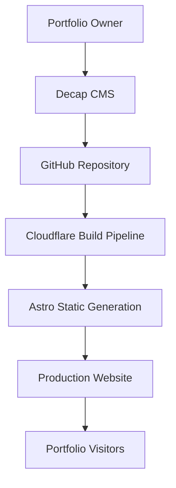

# Product Requirements Document (PRD)
## Personal Portfolio Website with Content Management System

| Document Information | Details |
|---|---|
| **Project Name** | Personal Portfolio Website |
| **Document Version** | 1.0 |
| **Created Date** | 24 October 2026 |
| **Status** | Proposed for Implementation |
| **Project Type** | Single-Page Personal Portfolio |
| **Development Approach** | Static-First Architecture |

---

# 1. Product Overview

## 1.1 Executive Summary

The project aims to develop a responsive personal portfolio website
for a creative professional, featuring storytelling, professional
experience, portfolio projects, and audio samples.

The website will be developed using Astro, TypeScript, Tailwind CSS,
and Decap CMS, with GitHub as the content repository and
Cloudflare Pages for deployment.

A non-technical portfolio owner must be able to update website
copywriting and structured project information independently
through a CMS.

Images and audio files will remain manually managed within
the project's asset directories.

## 1.2 Product Objectives

1. Establish a professional online portfolio that showcases
   the owner's creative work.
2. Provide a visually engaging and responsive browsing experience.
3. Enable independent content updates through a user-friendly CMS.
4. Maintain high performance, accessibility, and SEO quality.
5. Minimize infrastructure costs and ongoing maintenance.
6. Establish a maintainable frontend architecture for future
   enhancements.

## 1.3 Confirmed Product Decisions

| Category | Decision |
|---|---|
| CMS Editor | Non-technical portfolio owner |
| Website Structure | Single-page portfolio |
| Publishing Workflow | Direct publishing |
| Media Management | Manual repository management |
| Database | Not required |
| Hosting | Cloudflare Pages |

---

# 2. Target Users

## 2.1 Portfolio Visitors

Visitors should be able to:

- Understand the portfolio owner's background and expertise.
- Explore featured projects.
- Listen to available audio samples.
- Navigate easily between sections.
- Contact the portfolio owner.

## 2.2 Portfolio Owner

The owner should be able to:

- Sign in securely to the CMS.
- Update homepage copywriting.
- Add, edit, and remove project entries.
- Edit audio descriptions and metadata.
- Manage featured content and display order.
- Publish content without developer assistance.

The owner will not be responsible for uploading or modifying
media files through the CMS.

## 2.3 Developer

The developer will manage:

- Website source code.
- Visual components and styling.
- CMS configuration.
- Media assets.
- Content validation.
- Deployment and maintenance.

---

# 3. Product Scope

## 3.1 MVP Features

| ID | Feature | Priority |
|---|---|---|
| FR-01 | Responsive navigation | P0 |
| FR-02 | Hero section | P0 |
| FR-03 | About section | P0 |
| FR-04 | Featured portfolio projects | P0 |
| FR-05 | Audio showcase and playback | P0 |
| FR-06 | Contact and social links | P0 |
| FR-07 | CMS content editing | P0 |
| FR-08 | Direct content publishing | P0 |
| FR-09 | SEO metadata and sitemap | P0 |
| FR-10 | Asset-reference validation | P0 |
| FR-11 | Subtle UI animations | P1 |
| FR-12 | Dedicated project detail pages | P1 |
| FR-13 | Analytics integration | P2 |

### Priority Definitions

- **P0 — Must Have:** Required for the initial production release.
- **P1 — Should Have:** Implement after the MVP is stable.
- **P2 — Nice to Have:** Optional future enhancement.

## 3.2 Out of Scope

The initial release will not include:

- E-commerce functionality.
- User registration for public visitors.
- A custom application database.
- CMS-based media uploads.
- Multilingual content.
- A blog.
- Advanced search.
- A custom analytics dashboard.

These capabilities may be reconsidered in later versions.

---

# 4. Functional Requirements

## 4.1 Navigation

The website must provide navigation to its major sections.

### Acceptance Criteria

- Navigation links scroll to the corresponding sections.
- Navigation is usable on desktop and mobile devices.
- Mobile navigation supports keyboard interaction.
- Active and focused controls are visually distinguishable.

## 4.2 Hero Section

The Hero section introduces the portfolio owner.

### Required Elements

- Introductory label.
- Main headline.
- Supporting description.
- Hero image.
- Primary call-to-action.
- Optional secondary call-to-action.

All text and CTA labels must be editable through the CMS.

## 4.3 About Section

The About section provides information about the owner's
professional background, experience, and creative approach.

Content must be CMS-managed.

## 4.4 Featured Portfolio

The portfolio section displays a collection of featured projects.

### Project Data Requirements

Each project must support:

- Unique identifier.
- Title.
- Category.
- Year.
- Summary.
- Cover image path.
- Featured status.
- Display order.

Projects must be rendered using reusable components.

## 4.5 Audio Showcase

The Audio Showcase provides visitors with playable audio samples.

### Audio Data Requirements

Each audio entry must support:

- Title.
- Category.
- Description.
- Audio file path.
- Optional cover image.
- Featured status.
- Display order.

### Audio Player Requirements

- Play and pause.
- Playback progress.
- Seek functionality.
- Duration display.
- Loading and error handling.
- Accessible playback controls.
- Only one showcase player playing at a time.

Audio playback will use browser-native audio capabilities.

## 4.6 Contact Section

The Contact section must provide:

- Contact heading.
- Supporting copy.
- Email link.
- Social media links.
- Contact CTA.

The portfolio owner must be able to edit contact
information through the CMS.

---

# 5. Content Management Requirements

## 5.1 CMS Technology

Decap CMS will provide the content editing interface.

The CMS will use GitHub as its content backend.

## 5.2 Publishing Workflow

The approved workflow is direct publishing.

### Publishing Process

1. The portfolio owner signs in to the CMS.
2. The owner edits the relevant content.
3. The CMS saves the changes to the configured GitHub branch.
4. The deployment pipeline detects the change.
5. Astro validates the updated content and generates the website.
6. The updated website becomes publicly available after
   successful deployment.

### Publishing Architecture



## 5.3 Authentication

CMS authentication must be configured using a compatible
GitHub authentication solution.

The implementation must verify:

- Authorized editor access.
- Repository write permissions.
- Secure authentication handling.
- Ability to revoke editor access.
- Compatibility with Cloudflare hosting.

Authentication must be tested before the CMS is
considered production-ready.

## 5.4 Content Validation

Structured content must be validated using Zod schemas.

Validation must cover:

- Required fields.
- Data types.
- URL formats.
- Project identifiers.
- Display ordering.
- Asset path formats.
- Local asset existence.

Invalid content must not silently produce broken
production pages.

---

# 6. Media Management

## 6.1 Image Assets

Images will be stored in:

```text
public/images/
├── hero/
├── projects/
├── audio/
└── common/
```

## 6.2 Audio Assets

Audio files will be stored in:

```text
public/audio/
├── sample-01.mp3
├── sample-02.mp3
└── sample-03.mp3
```

## 6.3 Asset References

The CMS will store paths to manually maintained media files.

### Example Homepage Content

```yaml
hero:
  title: "Bringing Stories to Life"
  description: "A creative storytelling portfolio."
  image: "/images/hero/portrait.webp"
```

### Example Audio Content

```yaml
title: "A Story in the Forest"
category: "Narration"
description: "A short storytelling audio sample."
audioPath: "/audio/sample-01.mp3"
coverImage: "/images/audio/sample-01.webp"
featured: true
order: 1
```

The CMS will not upload, replace, or delete binary media files.

## 6.4 Asset Performance

- Images should use optimized formats where appropriate.
- Audio files should be compressed appropriately.
- Audio files must not be fully downloaded during initial
  page loading unless required.
- Image dimensions should be defined to prevent layout shifts.
- Missing local asset references must be detected before deployment.

---

# 7. Technical Architecture

## 7.1 Technology Stack

| Layer | Technology |
|---|---|
| Frontend Framework | Astro |
| Programming Language | TypeScript |
| Styling | Tailwind CSS v4 |
| Content Model | Astro Content Collections |
| Schema Validation | Zod |
| CMS | Decap CMS |
| Repository | GitHub |
| Hosting | Cloudflare Pages |
| Unit Testing | Vitest |
| End-to-End Testing | Playwright |
| Accessibility Testing | axe-core |
| Performance Testing | Lighthouse |

## 7.2 Architectural Principles

The implementation must follow these principles:

1. Separation of presentation components from content.
2. Reusable UI components.
3. Strongly typed content models.
4. Static HTML generation wherever possible.
5. Minimal client-side JavaScript.
6. Consistent design tokens.
7. Predictable project structure.
8. Automated validation before deployment.

## 7.3 Repository Structure

```text
personal-portfolio/
├── public/
│   ├── admin/
│   │   ├── index.html
│   │   └── config.yml
│   ├── images/
│   │   ├── hero/
│   │   ├── projects/
│   │   ├── audio/
│   │   └── common/
│   ├── audio/
│   ├── fonts/
│   └── favicon.svg
│
├── src/
│   ├── components/
│   │   ├── common/
│   │   ├── sections/
│   │   ├── portfolio/
│   │   └── audio/
│   │
│   ├── content/
│   │   ├── pages/
│   │   ├── projects/
│   │   └── audio/
│   │
│   ├── content.config.ts
│   │
│   ├── layouts/
│   │   └── BaseLayout.astro
│   │
│   ├── lib/
│   │   ├── content.ts
│   │   ├── media.ts
│   │   └── seo.ts
│   │
│   ├── pages/
│   │   ├── index.astro
│   │   └── 404.astro
│   │
│   ├── scripts/
│   │   └── audio-player.ts
│   │
│   └── styles/
│       ├── global.css
│       └── tokens.css
│
├── tests/
│   ├── unit/
│   └── e2e/
│
├── scripts/
│   └── validate-assets.mjs
│
├── astro.config.mjs
├── package.json
├── tsconfig.json
└── README.md
```

---

# 8. Nonfunctional Requirements

## 8.1 Performance

### Proposed Quality Targets

| Metric | Target |
|---|---|
| Lighthouse Performance | >= 90 |
| Lighthouse Accessibility | >= 95 |
| Lighthouse Best Practices | >= 95 |
| Lighthouse SEO | >= 95 |
| Largest Contentful Paint | <= 2.5 seconds |
| Interaction to Next Paint | <= 200 milliseconds |
| Cumulative Layout Shift | <= 0.1 |

These are acceptance targets to be verified under
representative test conditions.

## 8.2 Accessibility

The website must:

- Use semantic HTML.
- Support keyboard navigation.
- Provide visible focus indicators.
- Use appropriate text contrast.
- Provide accessible labels for interactive elements.
- Respect reduced-motion preferences.

## 8.3 SEO

The website must support:

- Page title and description.
- Canonical URL.
- Open Graph metadata.
- Structured heading hierarchy.
- Sitemap.
- Robots configuration.
- Descriptive image alternative text.

## 8.4 Maintainability

The project must implement:

- TypeScript strict mode.
- ESLint.
- Prettier.
- Consistent naming conventions.
- Component reuse.
- Content schema validation.
- Documented setup instructions.

---

# 9. Implementation Roadmap

| Phase | Deliverable | Estimated Effort |
|---|---|---|
| 1 | Project Foundation | 4–6 hours |
| 2 | Design System | 8–12 hours |
| 3 | Core UI Implementation | 12–18 hours |
| 4 | CMS Integration | 8–12 hours |
| 5 | Audio and Interaction | 4–6 hours |
| 6 | Testing and Optimization | 6–10 hours |
| 7 | Deployment and Handover | 3–6 hours |

**Total Estimated Effort: 45–70 focused development hours.**

This estimate excludes:

- Substantial design revisions.
- Delayed content preparation.
- Domain acquisition.
- Third-party authentication issues.

---

# 10. Phase 1 — Project Foundation

## 10.1 Objective

Establish a maintainable project foundation that supports
future UI development, content integration, testing,
and deployment.

## 10.2 Phase 1 Requirements

### P1-01 — Project Initialization

**Tasks:**

- [ ] Initialize Astro.
- [ ] Configure TypeScript strict mode.
- [ ] Install project dependencies.
- [ ] Establish the Git repository.

**Acceptance Criteria:**

- Development server starts successfully.
- Astro starter page renders without errors.

### P1-02 — Styling Foundation

**Tasks:**

- [ ] Install Tailwind CSS v4.
- [ ] Configure the Vite integration.
- [ ] Create global styles.
- [ ] Define temporary design tokens.

**Acceptance Criteria:**

- Tailwind utility classes render correctly.
- Global styling is applied consistently.

### P1-03 — Project Architecture

**Tasks:**

- [ ] Create component directories.
- [ ] Create layout directories.
- [ ] Prepare content directories.
- [ ] Prepare media directories.
- [ ] Create shared BaseLayout.

**Acceptance Criteria:**

- Placeholder homepage uses the shared layout.
- Directory structure follows the agreed architecture.

### P1-04 — Code Quality

**Tasks:**

- [ ] Configure ESLint.
- [ ] Configure Prettier.
- [ ] Install Astro checking tools.
- [ ] Configure TypeScript validation.
- [ ] Add npm validation scripts.

**Acceptance Criteria:**

- All configured static checks pass.

### P1-05 — Placeholder Homepage

Create a minimal responsive homepage containing:

- Page title.
- Introductory heading.
- Supporting description.
- Placeholder contact CTA.

**Acceptance Criteria:**

- Homepage renders correctly on desktop.
- Homepage renders correctly on mobile.
- No unintended horizontal overflow.

### P1-06 — GitHub Repository

**Tasks:**

- [ ] Create the GitHub repository.
- [ ] Establish branching conventions.
- [ ] Add appropriate `.gitignore` rules.
- [ ] Document development commands.
- [ ] Commit the initial project foundation.

**Acceptance Criteria:**

- Project can be cloned.
- Dependencies can be installed.
- Local development works using documented commands.

### P1-07 — Build Verification

Run the following commands:

```bash
npm run check
npm run lint
npm run format:check
npm run build
npm run preview
```

**Acceptance Criteria:**

- All commands succeed.
- The production preview renders correctly.

### P1-08 — CMS Readiness

Document:

- CMS content ownership.
- Repository write-access requirements.
- Authentication approach.
- Direct publishing behavior.
- Potential branch protection conflicts.

**Acceptance Criteria:**

- CMS integration dependencies are identified.
- No unresolved architectural assumptions prevent
  Phase 4 implementation.

## 10.3 Phase 1 Definition of Done

Phase 1 is complete when:

- [ ] Astro and TypeScript are operational.
- [ ] Tailwind CSS is configured.
- [ ] The base project structure exists.
- [ ] The placeholder homepage renders.
- [ ] Static checks pass.
- [ ] Production build succeeds.
- [ ] The Git repository is initialized.
- [ ] Development documentation is available.
- [ ] CMS authentication requirements are documented.

---

# 11. Testing Strategy

## 11.1 Unit Testing

Unit tests will cover:

- Content transformation utilities.
- Content validation.
- Asset path validation.
- Audio-related state utilities where applicable.

## 11.2 End-to-End Testing

End-to-end tests will cover:

- Navigation.
- Section visibility.
- Portfolio rendering.
- Audio playback controls.
- Contact links.

## 11.3 Manual Testing

Manual verification will cover:

- Desktop Chrome.
- Desktop Safari.
- Mobile Safari.
- Android Chrome.
- Keyboard navigation.
- Responsive layouts.
- Basic screen-reader accessibility.

---

# 12. Deployment Requirements

## 12.1 Hosting

The website will be deployed using Cloudflare Pages.

## 12.2 Build Configuration

| Setting | Value |
|---|---|
| Production Branch | `main` |
| Build Command | `npm run build` |
| Output Directory | `dist` |
| Rendering Mode | Static |

## 12.3 Deployment Validation

Production release requires:

- Successful production build.
- Valid generated HTML.
- No broken asset references.
- Working navigation and audio.
- Valid metadata.
- Successful CMS publishing test.

## 12.4 Rollback

The deployment process must support recovery using
previous Git commits and deployments.

---

# 13. Risks and Mitigation

| Risk | Mitigation |
|---|---|
| CMS authentication fails | Validate authentication before final CMS integration |
| Direct publishing introduces invalid content | Use schema validation and automated build checks |
| Media files are missing | Validate file references during build |
| Audio files become too large | Compress assets and evaluate object storage |
| UI differs from Stitch reference | Perform visual comparison and responsive QA |
| Owner struggles with CMS | Use clear field labels and provide an editor guide |
| Branch protection blocks CMS commits | Configure a compatible repository policy |

---

# 14. Open Decisions

The following items require confirmation before
their respective implementation phases:

1. Final portfolio owner name and branding.
2. Production domain.
3. Final Stitch design files and assets.
4. CMS authentication provider and potential cost.
5. GitHub account and repository access for the editor.
6. Initial portfolio and audio content.
7. Final contact details and social links.
8. Content language.
9. Analytics and privacy requirements.

---

# 15. Product Acceptance

The MVP will be accepted when:

1. All P0 functionality is implemented.
2. The design is approved against the Stitch reference.
3. The website passes agreed quality checks.
4. The owner can independently update content through the CMS.
5. Direct publishing works correctly.
6. Manual media references resolve successfully.
7. Production deployment is stable.
8. Documentation and handover are complete.

---

**Document Version:** 1.0  
**Status:** Proposed for Implementation

**End of Product Requirements Document**